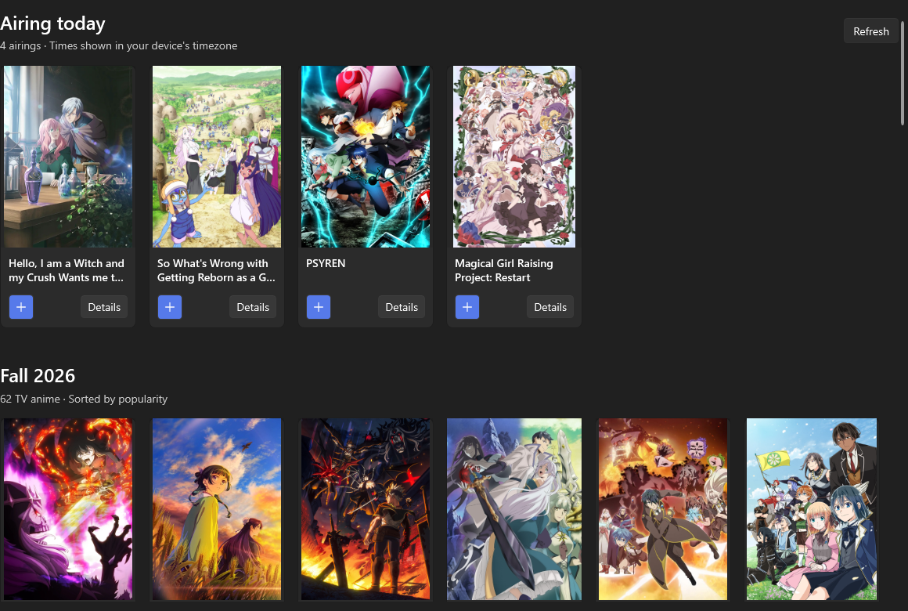
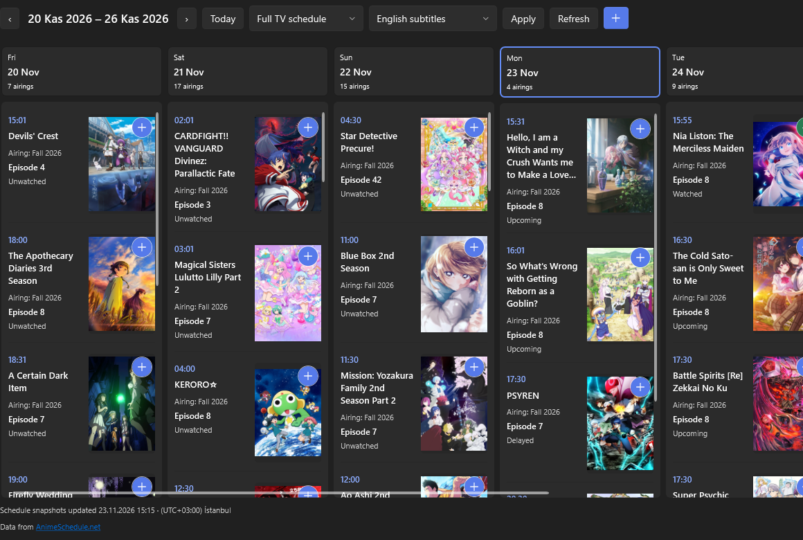
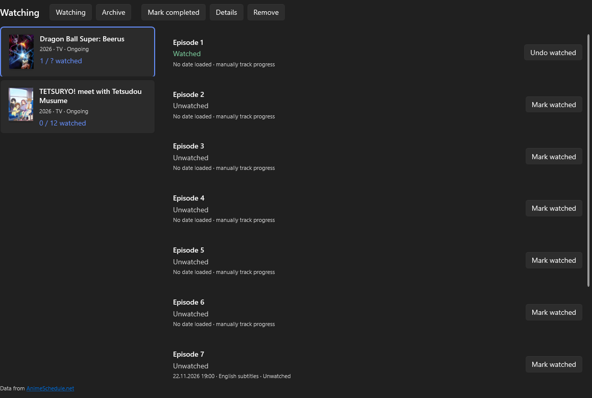
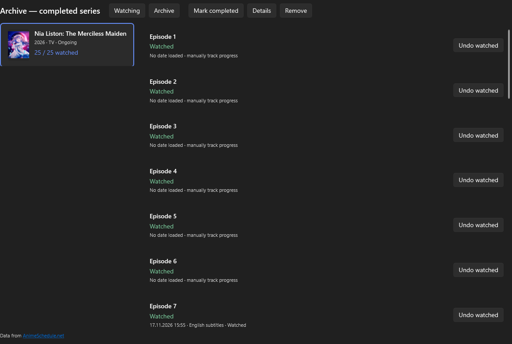

# SlotCast

A Windows desktop app for discovering TV anime, following weekly airing schedules, and keeping track of watched episodes. Built with WPF, WPF UI, CommunityToolkit.Mvvm, and Entity Framework Core with SQLite.

## Features

- **Home:** airing today, the current anime season, new releases, trending titles, and upcoming premieres.
- **Weekly calendar:** your library or the full TV anime schedule, with local times, posters, episode numbers, and watched controls.
- **Release options:** English subtitles, Japanese broadcasts, and English dubs.
- **Discover:** search TV anime and open details inside the app. OVAs and other non-TV formats are excluded.
- **Watching and Archive:** track individual episodes, mark a series completed, and automatically archive titles when all known episodes are watched.
- **Updates:** checks stable GitHub releases at startup and downloads the Windows installer when you choose to update.
- **Local storage:** your library and progress stay on your PC and survive app updates.
- **JSON backups:** export your library and merge it onto another PC without losing existing progress.
- **Flat UI:** dark and light themes, wrapped poster cards, and no gradients.

The current implementation focuses on **anime**. Separate TV drama and movie tracking is not implemented yet.

## Screenshots

Actual app pages rendered with example watch history and live provider data in an isolated temporary database. Posters and availability belong to their respective providers and rights holders; schedules change over time. These captures show page content without the surrounding window and navigation shell.

### Home



### Weekly calendar



### Watching



### Archive



## Get started

Use a self-contained Windows x64 installer built from this repository, or build from source below. The installer does not require a separate .NET runtime installation.

SlotCast does not ask users to sign in to SIMKL or AnimeSchedule. **AnimeSchedule features still require an application API token** configured on the device. The installer deliberately excludes the developer's private token.

On first launch, paste your token into the **AnimeSchedule connection** box on Home and choose **Save token**. SlotCast validates it, saves it on your PC, and refreshes immediately. You can replace it later in Settings. The saved file is `%LOCALAPPDATA%\SlotCast\appsettings.local.json`, separate from the application folder; updates retain it.

For manual or development configuration, you can still create `appsettings.local.json` alongside `SlotCast.exe` (or in the repository root when developing):

```json
{
  "AnimeScheduleApiToken": "YOUR_ANIMESCHEDULE_APPLICATION_TOKEN"
}
```

Saving through the app takes effect immediately. Restart after manually changing configuration files. This local file is ignored by Git. Do not put private tokens in tracked `appsettings.json` or distribute them in a public release.

SIMKL's public trending feed uses the client ID configured in `appsettings.json`. Personal SIMKL account tokens are not used. See [configuration](docs/configuration.md) for details.

## Build and run

Requirements: Windows, a .NET SDK capable of targeting .NET 10, and NuGet access. The project targets `net10.0-windows`; its current `Microsoft.Extensions.*` dependencies are version 11. The current build has been validated with the .NET 11 SDK.

From the repository root:

```powershell
dotnet restore SlotCast.csproj
dotnet build SlotCast.csproj
dotnet run --project SlotCast.csproj
```

To build a self-contained app:

```powershell
dotnet publish SlotCast.csproj -p:PublishProfile=WindowsSelfContained
```

To build the installer, install [Inno Setup 6](https://jrsoftware.org/isinfo.php), then run:

```powershell
.\scripts\build-installer.ps1
```

The installer and its SHA-256 checksum are written to `artifacts/installer/`. See the [development guide](docs/development.md) for validation, packaging, and screenshot capture commands.

## Your data

The database lives at `%LOCALAPPDATA%\SlotCast\slotcast.db`, outside the installation directory. Updates and the current uninstaller leave this data in place.

Use **Settings → Export watchlist to JSON**, then copy the file to another PC and choose **Settings → Import watchlist from JSON**. Imports merge titles and watched episodes, preserve existing progress, and restore the release schedule preference. Manual completion is included. API tokens and downloaded schedule caches are excluded.

See the [user guide](docs/user-guide.md) for calendar behavior, completion rules, backups, and troubleshooting.

## Documentation

- [Using SlotCast](docs/user-guide.md)
- [Configuration and credentials](docs/configuration.md)
- [Development, architecture, and packaging](docs/development.md)
- [Internal deployment guide and command summary](docs/deployment.md)

## Data sources

[AnimeSchedule.net](https://animeschedule.net/) provides anime search, metadata, posters, seasonal lists, and airing schedules. [SIMKL](https://simkl.com/) supplies public trending data and matching title details. SlotCast is not affiliated with either service.

Subtitle schedules can fall back to Japanese broadcast times; each calendar entry identifies its source. Schedule snapshots may become stale when offline, and providers can change release times. The app reports missing or stale weeks rather than predicting dates.

## License

SlotCast's project code is licensed under the **GNU General Public License v3.0 or later** (`GPL-3.0-or-later`). See [LICENSE](LICENSE) for the full terms. Third-party dependencies, provider data, artwork, and service access remain subject to their own licenses and terms; the GPL grant does not relicense those materials.

Copyright (C) 2026 SlotCast contributors.
